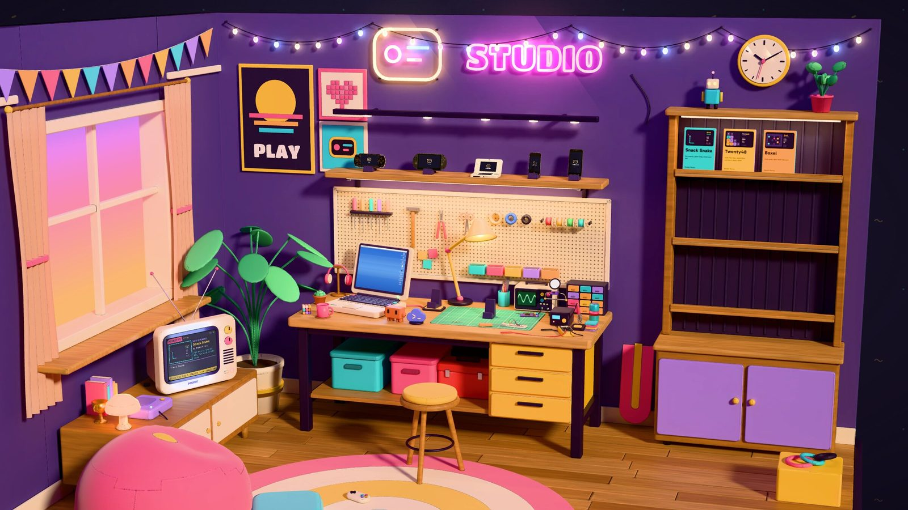
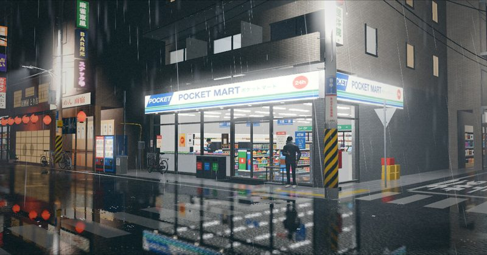
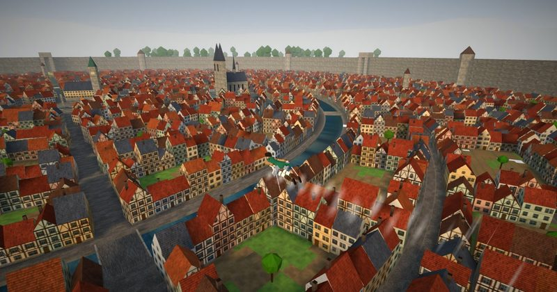
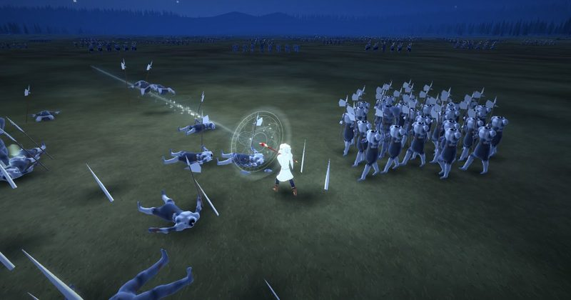
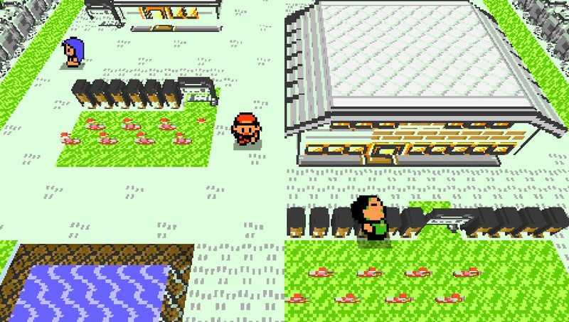
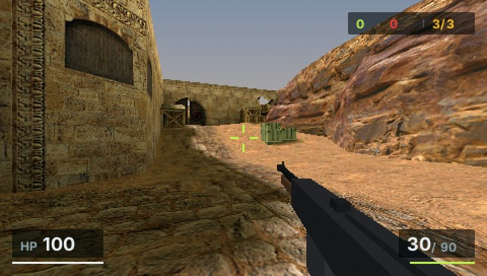

# Pocket Nexus

An independent lab exploring new possibilities in computing, interaction and creation.

[pocket.nexus](https://pocket.nexus) · [X](https://x.com/pocket_js) · [Discord](https://discord.gg/cTce4eXzSK)

## Pocket Studio

Make a game with your coding agent, in a room of your own. It runs on the handheld you kept and the phone you never threw away.

The room is a web page. Claude Code or Codex writes the game on your computer, and each build reaches a PSP, a PS Vita, a Nintendo 3DS, an iPod touch or an Android phone on the shelf a few seconds after it is saved. Publish a game and it gets a case on the shelf and its own address: friends play it in a browser, or take it home to their own device.

**[Open Pocket Studio](https://studio.pocket.nexus)** · [Documentation](https://studio.pocket.nexus/docs/) · [日本語](https://studio.pocket.nexus/ja/)

## Technology

- **[PocketJS](https://pocketjs.pocket.nexus)**: create UI on every screen you love. Apps written as JavaScript components, drawn as native pixels on handhelds, desktops and embedded screens. [Source](https://github.com/pocket-nexus/pocketjs)
- **[Pocket3D](https://3d.pocket.nexus)**: create 3D for every machine you love. A scene written once in Three.js, a compiler that lowers it for each console, and a renderer for each console's GPU. [Source](https://github.com/pocket-nexus/pocketjs/tree/main/pocket3d)
- **[MicroTS](https://github.com/pocket-nexus/pocketjs/tree/main/microts)**: TypeScript compiled ahead of time to native code.

## Games on Pocket Studio

Each one runs in a browser tab and on the handhelds it was built for. Their pages on Pocket Studio have recordings and the packages for each device.

<table>
<tr>
<td width="50%" valign="top">

<b>Pocket Tokyo</b> 
A flight over Shiba, around Tokyo Tower. PS Vita, PSP, Nintendo 3DS, iPod touch, Android. 
<a href="https://tokyo.studio.pocket.nexus">Play in your browser</a> · <a href="https://studio.pocket.nexus/games/tokyo">Page</a> · <a href="https://github.com/pocket-nexus/pocket-tokyo">Source</a>
</td>
<td width="50%" valign="top">

<b>Pocket Atlas</b> 
Seven real places to stand in, from a Tokyo backstreet in the rain to Griffith Observatory after sunset. PS Vita, PSP, Nintendo 3DS, iPod touch, Android. 
<a href="https://atlas.studio.pocket.nexus">Play in your browser</a> · <a href="https://studio.pocket.nexus/games/atlas">Page</a> · <a href="https://github.com/pocket-nexus/pocket-atlas">Source</a>
</td>
</tr>
<tr>
<td width="50%" valign="top">

<b>Pocket Maneuver</b> 
Two wires, a tank of gas, a walled town. PS Vita, PSP, Nintendo 3DS, iPod touch. 
<a href="https://maneuver.studio.pocket.nexus">Play in your browser</a> · <a href="https://studio.pocket.nexus/games/maneuver">Page</a> · <a href="https://github.com/doodlewind/pocket-maneuver">Source</a>
</td>
<td width="50%" valign="top">

<b>Pocket Requiem</b> 
One mage against a headless army, on a field at night. PS Vita, PSP, Nintendo 3DS. 
<a href="https://requiem.studio.pocket.nexus">Play in your browser</a> · <a href="https://studio.pocket.nexus/games/requiem">Page</a> · <a href="https://github.com/doodlewind/pocket-requiem">Source</a>
</td>
</tr>
</table>

## Mods

The engines behind Pocket Studio also run mods. These two read files from a game you own, so Pocket Studio shows them as demos. The code is open: take it and make it yours.

<table>
<tr>
<td width="50%" valign="top">

<b>Pocket Voxel</b> 
A Game Boy creature-RPG as a voxel diorama, built from your own ROM. PSP, PS Vita, iPod touch and a browser. 
<a href="https://github.com/pocket-nexus/pocket-voxel">Source</a>
</td>
<td width="50%" valign="top">

<b>OpenStrike</b> 
A CS-like FPS on classic BSP maps from your own copy of the game. PSP, PS Vita, Nintendo 3DS, iPod touch and desktop computers. 
<a href="https://github.com/pocket-nexus/open-strike">Source</a>
</td>
</tr>
</table>

## More from the lab

- [Pocket Term](https://github.com/pocket-nexus/pocket-term): a terminal client for the Nintendo 3DS. The shells run on your Mac; the console shows 80 columns by 24 rows.
- [Pocket Vault](https://github.com/pocket-nexus/pocket-vault): a Markdown vault on the Nintendo 3DS. A companion on your Mac indexes the notes in SQLite.
- [Pocket YouTube](https://github.com/pocket-nexus/pocket-youtube): YouTube on a PSP, a PS Vita and a New Nintendo 3DS, with a Mac companion.
- [Pocket Figma](https://github.com/pocket-nexus/pocket-figma): a Figma file viewer for the PSP and the PS Vita, baked into tile pyramids at compile time.
- [Pocket Retro](https://github.com/pocket-nexus/pocket-retro): Pyxel games compiled for the Game Boy Advance.
- [PocketPi](https://github.com/pocket-nexus/pocket-pi): a runtime for installable, updatable JavaScript apps on embedded devices, for people and coding agents.
- [quickjs-oxide](https://github.com/pocket-nexus/quickjs-oxide): a Rust rewrite of QuickJS with no unsafe code.

Toolchains for the handhelds: [rust-psp](https://github.com/pocket-nexus/rust-psp), [pspdev](https://github.com/pocket-nexus/pspdev) and [quickjs-rs](https://github.com/pocket-nexus/quickjs-rs).
